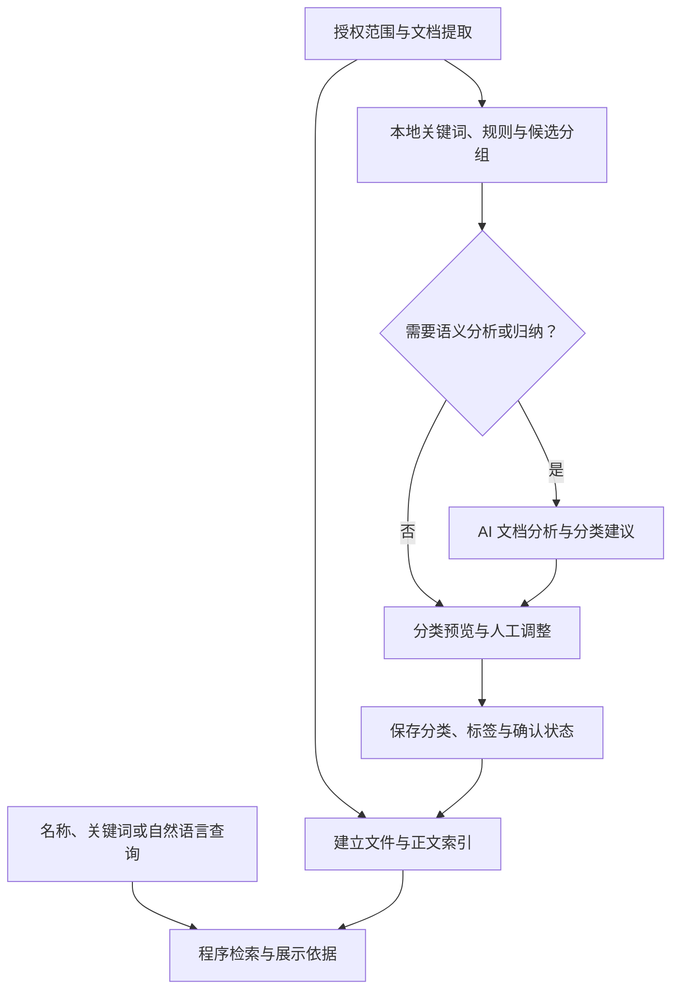
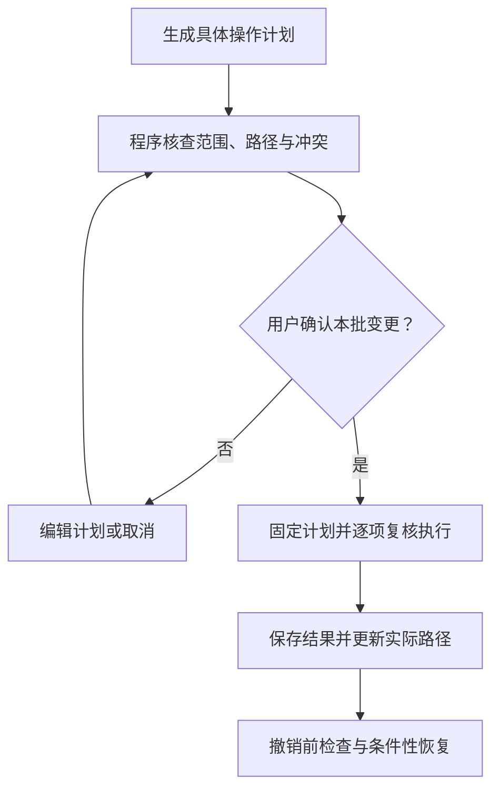

# FolioMind · 智序文件管家

> **融合本地内容分析与 AI 辅助的文档分类、整理与检索系统**  
> **FolioMind — AI-Assisted Document Organization and Retrieval**

**项目类型：** 人工智能应用课程设计 / Windows 桌面客户端  
**项目阶段：** 需求调整与二次开发规划版，非已完成产品说明  
**主要运行平台：** Windows 桌面客户端；用户安装并启动独立应用窗口，在客户端中选择本地目录、分类整理和检索，无需通过浏览器使用  
**开源原型：** [Param2k23/FilePilot-AI](https://github.com/Param2k23/FilePilot-AI)  
**本次设计更新：** 2026-11-08

> **状态说明：** “原型已有”沿用前版对开源原型的描述，不表示本次重新核验了仓库代码；“目标设计”与“拟实现”表示 FolioMind 的开发方向。功能是否完成，以代码、运行结果和测试记录为准。文中的算法、模型选型和优先级建议不代表已验证效果。

---

## 1. 项目简介与首版范围

FolioMind 是面向学生的本地桌面客户端，用于整理和查找课程资料、笔记及实验报告。系统对用户明确选定的目录提取文档文字、建立索引，通过本地关键词分析和规则形成初步建议，并在需要时使用 AI 辅助理解主题、概括内容、提出标签、处理分类歧义、归纳分组和解析自然语言查询。

普通程序也能提取正文、统计词频和进行全文关键词检索；这些能力本身不需要大语言模型。AI 的价值需要体现在上下文判断、内容归纳及不同表达之间的关联上，并通过与纯本地方案的对照测试验证。

系统区分三个对象：**分类与标签关联、文件实际存放位置、文件操作计划**。一个文件可以关联多个主题或类别，在多个视图中出现，而实际位置保持一处；分类浏览不应自动复制或移动文件。用户需要物理整理时，再审核具体计划，由本地程序执行。

### 1.1 首版支持的文档类型（已确定）

| 类型 | 后缀 | 首版目标能力 | 边界 |
| --- | --- | --- | --- |
| 纯文本 | `.txt` | 提取可解码正文，用于分析与检索 | 无法正确解码时提示失败，不将乱码当作有效内容 |
| Markdown | `.md` | 提取标题与正文用于分析与检索 | 不自动访问其中的外部链接或读取关联附件 |
| Word 文档 | `.docx` | 提取正文及可读取的表格文字 | 不承诺还原复杂排版、文本框、嵌入对象或图片中的文字 |
| 文字型 PDF | `.pdf` | 提取文件已有文字层用于分析与检索 | 提取顺序或质量可能有偏差，需检查可用性；不对空白或混乱结果强行分析 |

**首版不包含 OCR。** 扫描型 PDF、图片中的文字不进入正文理解和全文检索；如 PDF 同时包含文字页和扫描页，应提示可能只覆盖部分内容。无可用正文、加密、损坏或不支持的文件应显示原因，可保留名称等可读元数据、供人工分类或跳过，不声称已经理解内容。

旧版 `.doc`、PPT/PPTX、Excel/XLSX、图片、压缩包、安装包、音视频不纳入首版内容分析。首版不自动解压、不运行文件、不遍历未授权范围。OCR 和其他格式作为后续扩展，届时单独实现与验收。

### 1.2 建设目标与典型任务

1. **减少整理负担：** 生成可调整的分类与标签建议，减少逐份打开文档和手动命名类别的工作。
2. **改善找回体验：** 支持名称、正文关键词与条件搜索，并按需辅助理解用户的含糊描述。
3. **保留用户控制：** 允许修改名称、合并或拆分分组、调整归属；物理操作另行确认。
4. **限制内容和权限范围：** 仅分析授权目录，模型提供建议，本地程序负责校验和执行。
5. **验证 AI 的贡献：** 比较准确性、人工修改量、耗时和搜索命中情况，不以模型调用次数作为价值依据。

典型任务包括：归纳一批课程笔记的主题；为一份跨主题项目报告选择多个标签；查找记不清名称的资料；在审核后将选中的散装文档整理到指定位置；核对并撤销仍满足恢复条件的操作。

---

## 2. 功能范围与 AI 职责

### 2.1 开源原型能力（沿用前版说明）

| 模块 | 功能 | 简要说明 | 状态 |
| --- | --- | --- | --- |
| 文件扫描 | 指定目录扫描 | 读取待整理目录中的文件信息，过滤排除项 | ✅ 原型已有 |
| AI 智能分类 | 模型生成目标目录 | 调用本地 Llama 3.2，根据文件名、扩展名及有限文本预览生成分类建议 | ✅ 原型已有 |
| 整理预览 | Dry Run 模式 | 先展示计划移动的位置和理由，不实际改变文件 | ✅ 原型已有 |
| 文件归档 | 自动移动 | 执行建议的文件移动，必要时创建目标子目录 | ✅ 原型已有 |
| 同名冲突处理 | 避免直接覆盖 | 目标文件名重复时添加短后缀，生成不冲突的新路径 | ✅ 原型已有 |
| 自然语言检索 | 语义查找 | 使用 ChromaDB 检索**已建立索引的文件移动记录** | ✅ 原型已有 |
| 对话式交互 | 识别查询意图 | 支持搜索、展示记录、撤销等文本意图 | ✅ 原型已有 |
| 历史记录 | 整理记录持久化 | 保存移动索引和聊天历史，便于后续访问 | ✅ 原型已有 |
| 撤销整理 | 文件位置恢复 | 根据原路径和目标路径恢复已记录的移动操作 | ✅ 原型已有 |
| 安全排除 | `.aiignore` | 排除指定文件、扩展名或目录 | ✅ 原型已有 |
| 多种操作入口 | Web UI 与 CLI | 既可通过 Streamlit 使用，也可运行命令行命令 | ✅ 原型已有 |

**现有能力边界：** 原型的文件内容预览主要是读取文件的前少量字节并按 UTF-8 尝试解码；这**不等于**可靠解析 PDF、DOCX 或图片内容。现有语义索引侧重整理过的文件记录，尚不等于给任意指定目录建立完整的全文知识库。


### 2.2 AI 的目标职责

以下是拟支持的能力范围，不代表每项独立调用模型，也不表示全部必须进入首个可运行版本。

| AI 功能 | 输入与职责 | 输出及边界 |
| --- | --- | --- |
| 文档语义理解 | 结合标题、正文及上下文，判断主要主题、用途与次要内容 | 主题、用途及依据；信息不足时标记待确认，不补造事实 |
| 内容概括 | 概括文档主要内容，辅助辨认文件和分类 | 简短摘要，不能代替真实正文；展示时标明为生成内容 |
| 多标签建议 | 从课程、主题、项目、用途等维度提出标签 | 可修改标签；“待确认”等操作状态不混作主题标签 |
| 歧义分类辅助 | 对规则未命中、候选冲突或跨主题文档补充分析 | 候选类别、依据和待确认原因，不强制唯一归类 |
| 分组归纳与命名 | 综合候选组的代表性标题、关键词和必要片段 | 类别名称与共同主题；发现不一致时提示核对，不用名称掩盖错误分组 |
| 分类方案建议 | 参考用户偏好，提出按课程、项目或用途组织的结构 | 可比较和编辑的方案，用户确定最终结构与文件归属 |
| 自然语言查询理解 | 解析含糊描述，提取关键词、相关概念与筛选条件 | 结构化查询建议；程序构造检索，不执行模型生成的任意查询代码 |

文档理解、摘要、标签及候选分类可在一次分析中共同生成并缓存。能由规则明确处理的文件不必额外调用模型。AI 不仅给分组起名字：复杂文件可按需提供足够的相关正文进行语义判断；片段不足时补充内容或保留待处理，不假定关键词已经完整表达原文。

### 2.3 本地程序职责与可选增强

| 环节 | 普通本地程序职责 | 模型参与方式 |
| --- | --- | --- |
| 读取 | 扫描授权范围、提取元数据与支持格式的文字 | 不向大模型开放任意文件读取工具 |
| 基础分析 | 分词、过滤常见词、计算关键词权重、规则匹配、形成候选分组 | 按需调用 AI 处理语义问题，具体方法待测试 |
| 数据管理 | 保存文件、分类、标签、用户修改、索引和任务记录 | 模型不能直接改写业务数据库或授权配置 |
| 基础检索 | 名称、正文关键词、标签、路径和时间等条件检索及结果排序 | 明确查询直接检索；含糊查询可使用模型解析 |
| 真实操作 | 计划校验、移动、重命名、同名冲突、日志和条件性撤销 | 模型只提供分析或命名建议，不持有执行接口 |

可选增强包括：**语义检索**（嵌入模型生成语义表示，本地程序检索）；**智能命名**（AI 建议主题和用途，程序按模板生成名称）；**精确去重**（本地大小与内容哈希比较，不需大模型）。OCR、文档问答及其他格式解析不进入当前首版。

### 2.4 建议开发优先级与待定设计

| 级别 | 建议内容 | 状态 |
| --- | --- | --- |
| P0 基础闭环 | 四类文档提取、范围排除、关键词与规则分析、独立文件索引、基础搜索、人工分类与标签编辑 | 拟实现 |
| P0 AI 验证 | 验证文档语义判断、摘要/标签输出及候选分组命名，记录失败与人工修改 | 待验证后确定模型和调用策略 |
| P1 分类和检索增强 | 方案比较、歧义处理交互、自然语言查询理解、增量更新；按效果决定向量检索 | 拟实现，具体顺序待定 |
| P1 物理整理 | 可编辑计划、范围校验、明确确认、冲突处理、逐项日志及条件性撤销 | 提供移动功能时必须完整实现，不以裸移动接口替代 |
| P2 效率扩展 | AI 命名建议、精确重复检测、统计看板、可选后台监听 | 后续扩展 |

以下尚未确定：①原位管理与物理整理在首版界面中的主次；②用户先选择分类维度还是先查看系统方案；③大模型及分组方法的最终选型；④是否引入嵌入模型与向量检索。当前保留原位浏览与审核后整理两条路径，不将未决项写成已完成需求。移动等修改性操作始终需明确确认。

---

## 3. 技术栈与实现分工

### 3.1 已有开源原型技术栈

| 层次 | 技术 | 作用 |
| --- | --- | --- |
| 开发语言 | Python 3.10+ | 系统核心逻辑、文件操作及 AI 接口调用 |
| 用户界面 | Streamlit | 提供文件整理页面、语义搜索和对话交互 |
| 本地模型服务 | Ollama | 运行和调用本地大语言模型 |
| 大语言模型 | Llama 3.2 | 根据文件元数据与内容预览生成分类建议 |
| 向量数据库 | ChromaDB | 保存相关记录并提供向量语义检索 |
| 数据模型 | Pydantic | 校验分类决策、文件记录等结构化数据 |
| 命令行工具 | Typer、Rich | 提供 CLI 命令和格式化终端输出 |
| 文件系统操作 | `pathlib`、`shutil` | 遍历目录、获取路径信息、移动文件与恢复 |
| 网络请求 | HTTPX、Ollama Python Client | 模型服务连通性检查、与 Ollama 交互 |
| 本地持久化 | ChromaDB 本地目录、JSON 文件 | 保存移动记录索引和聊天历史 |

**产品形态说明：** FilePilot-AI 参考原型采用 Python + Streamlit，浏览器界面仅属于原型的既有实现。FolioMind 的交付形态已确定为 **Windows 桌面客户端**，需要复用并改造可用的 Python 核心逻辑，重新实现桌面交互与打包启动流程；不以 Streamlit 页面或浏览器访问地址作为产品入口，也不要求部署 Web 站点或远程业务服务器。


### 3.2 FolioMind 拟增加的职责与候选组件

| 职责 | 候选实现 | 说明 |
| --- | --- | --- |
| 桌面界面 | Python 桌面 GUI 框架（如 PySide6，具体选型待验证） | 独立应用窗口，提供本机目录选择、文件列表、分类编辑、搜索和操作确认 |
| 后台任务与界面通信 | 后台工作线程/任务队列及 GUI 框架的消息机制 | 扫描、解析、索引与模型请求不阻塞界面；反馈进度、错误和取消状态 |
| 客户端打包与启动 | 与所选 GUI 框架兼容的 Windows 打包方案 | 提供可执行程序或安装包，明确本地数据目录与模型依赖；发布方式待实现验证 |
| TXT/MD 提取 | Python 文本读取与必要的编码处理 | 读取失败需明确反馈；Markdown 链接不作为额外访问授权 |
| 文字型 PDF 提取 | PyMuPDF 或经测试的其他解析器 | 首版不启用 OCR，检查文字覆盖范围和提取质量 |
| DOCX 提取 | python-docx 或经测试的其他解析器 | 验证正文与可读取表格文字的覆盖情况 |
| 本地关键词与分组 | 中文分词、词频/TF-IDF、相似度及聚类等候选方法 | 按标题、正文、目录等线索评估；算法、权重和粒度待实验确定 |
| 文件/标签/任务数据 | SQLite 等本地持久化方案 | 与正文索引、可选向量索引分工，支持多对多标签关联 |
| 名称和正文索引 | 经验证的本地全文索引方案 | 中文匹配、筛选与更新能力需测试，不依赖是否移动文件 |
| 大语言模型 | 沿用 Ollama 本地推理路线，具体模型待评估 | 前版 Llama 3.2 仅作为原型选型；比较中文效果、资源占用与耗时 |
| 可选语义索引 | 嵌入模型与 ChromaDB 等候选方案 | 分别说明表示生成与向量检索职责，不能只列数据库而省略模型 |
| 变化更新 | 手动刷新/增量扫描；后台监听可后置 | 后台分析只更新建议与索引，不等于自动移动 |
| 精确去重 | `hashlib` 等本地实现 | 相同名称或相似主题不等于内容重复 |

以 Python 核心逻辑作为复用基础，FolioMind 通过桌面界面调用本地应用服务，连接文件系统、本地数据库、索引和 Ollama 模型服务。界面层与业务层解耦；本地模型服务通信不改变桌面客户端的产品形态。GUI 框架、打包工具与进程组织尚待验证，不将候选选型写成已经实现。Streamlit 仅保留为参考原型的验证入口，原型依赖与客户端依赖分别维护。

---

## 4. 系统架构与工作流程（目标设计）

### 4.1 分析、分类和检索



未确认建议与已确认分类分开保存。初次扫描即对可提取内容建立索引，文件无需先移动；物理位置发生变化后再更新路径。自然语言查询按需解析为条件，向量检索作为待定增强，不是所有搜索的前置条件。

### 4.2 文档分析与分类流程

1. 用户选择授权目录、排除项及本次范围；“纳入管理”不自动复制或移动文件。
2. 提取四类支持格式的可用文字；解析失败、无正文或仅部分可读时显示状态和原因。
3. 本地程序提取标题、关键词与权重，匹配用户规则和已确认分类，形成候选分组。
4. 按需调用 AI 分析文档主题、用途和标签，概括内容；对歧义补充正文，对分组建议名称。仅提供经过范围控制且有助于任务的内容。
5. 程序验证结构化输出、文件标识与类别引用；未知对象、无效结构或异常输出不进入执行流程。
6. 用户查看依据，修改类别、合并或拆分组、调整归属和标签；跨主题允许多标签，不强制唯一主题。
7. 保存已确认分类与用户修正；是否将某次修正保存为长期规则，由用户选择，不宣称模型已经自动训练。
8. 物理整理作为单独流程，按用户选择的唯一目标位置生成操作计划。

关键词相似不能证明应当同组。现有目录可能是用户的组织线索，也可能正是待整理的混乱来源；应区分“参考已有结构”和“重新提出方案”。分类数量、层级和粒度需经测试并允许调整，新增文件不应未经同意重组已确认类别。

### 4.3 物理整理与权限边界



AI 不获得任意文件读写、移动、删除、Shell、权限修改或数据库执行工具。模型只接收程序提供的内容、返回分析或建议；真实操作由程序按固定计划执行。安全边界不能只靠提示词或 JSON 类型检查，也不能把拆分 Python 模块当作操作系统级隔离。

路径和范围检查、未知文件拒绝、禁止静默覆盖、链接越界检查以及执行前状态复核均由程序负责。代码项目、应用数据等结构相关目录需排除或整体保留，不因位于非系统盘就认定可任意拆分。暂停只阻止后续操作；部分成功需如实记录，撤销不承诺恢复外部任意改动。

### 4.4 AI 分析结果示例（说明性设计，非现有协议）

```json
{
  "file_id": "F023",
  "main_topic": "TCP 拥塞控制",
  "document_purpose": "实验报告",
  "summary": "比较不同条件下的 TCP 拥塞控制实验结果。",
  "suggested_tags": ["计算机网络", "TCP", "实验报告"],
  "candidate_categories": [
    {
      "category_id": "network_lab",
      "reason": "标题与实验步骤涉及 TCP 拥塞控制。"
    }
  ],
  "needs_classification_review": true,
  "review_reason": "需要用户确认所属课程及最终分类。"
}
```

`file_id` 和已有 `category_id` 必须对应本批允许对象；新类别名称属于待审核建议，由程序分配标识。正文依据应能回到真实标题或片段核对，不把生成理由当成事实证明，不输出未经校准的可信百分比。`needs_classification_review` 只表示分类歧义，**任何取值都不能授权文件移动或跳过用户确认**。模型输出不包含可直接执行的绝对路径或系统命令。

---

## 5. 主要模块与数据设计（目标设计）

### 5.1 范围、读取与基础分析

本模块负责授权目录、可视化排除、文件清单、解析状态、标题与正文提取、关键词权重及候选分组。区分“未分析、分析中、已完成、部分可读、失败、不支持”，显示原因并支持取消后续分析。部分可读文档只能检索已提取内容。

排除规则应在内容读取前生效；不自动访问 Markdown 外部链接、执行宏或脚本、不打开压缩包内容。仅移动或改名不得被当作正文一定发生变化。

### 5.2 语义分析、分类与多标签

单文档分析和多文档归纳共享基础数据：按需理解主题/用途，生成摘要、标签与候选分类；综合候选组归纳名称，或按用户偏好提出分类结构。若当前材料不够判断，应补充允许范围内的内容或保留待确认。

界面支持修改名称、合并/拆分类别、批量调整文件归属、添加/删除标签、选择保持原位或生成物理整理计划。优先审核整体方案，仅将冲突或不明确文件单独列出，避免每个文件弹出多个候选造成新的负担。

“计算机网络”是主题，“实验报告”是用途，“FolioMind”是项目，“待确认”是任务状态；分维度保存和展示。一个文件可关联多个类别或标签，但物理操作计划只能指定一次操作的一个目标位置，不自动复制到所有分类。

### 5.3 本地执行、日志与撤销

输入为经过用户确认的固定操作计划，而非模型的原始回答。程序再检查来源与目标范围、文件身份与当前状态、可写性、同名冲突和路径变化，逐项执行并保存原路径、目标路径、状态、原因和时间。

同名不得静默覆盖，可选择跳过或确认采用新名称。模型建议改名时，日期、作者、版本仅使用已核实信息，程序保留扩展名并处理非法字符。删除不进入自动分类执行清单；去重仅生成候选报告，不自动永久删除。

撤销前检查源目标占用和文件状态；无法恢复时列出原因，不用统一“成功”掩盖部分失败。操作日志不能代替备份。

### 5.4 搜索与结果核验

| 查询类型 | 目标处理方式 |
| --- | --- |
| 名称/路径关键词 | 本地名称索引，返回直接命中与当前位置 |
| 正文关键词 | 检索已提取正文，显示命中片段和覆盖范围 |
| 类别、标签、类型、时间等 | 本地结构化条件筛选，区分日期字段含义 |
| 自然语言描述 | AI 按需提取条件、扩展相关词，程序执行检索；允许用户修正条件 |
| 可选语义检索 | 嵌入模型生成查询和内容表示，程序检索相近内容；效果通过测试决定 |

例如“找包含 Redis 的 PDF”可直接使用关键词与类型筛选；“找无效请求直接打到数据库的笔记”可扩展“缓存穿透”等概念或使用语义匹配。两类方案都可能漏检或误检，需要返回真实候选和依据。

“上学期”“老师发的”等条件仅在系统有可靠记录或用户补充信息时使用，不能把修改时间等同收到时间，也不能凭空推断来源。搜索仅覆盖授权且索引可用的范围；显示未完成、过期、无结果与路径失效等不同状态。文件无需移动即可搜索，不宣称未建立的全文或向量索引已经可用。

### 5.5 文件、分类、索引与任务信息

| 对象 | 目标保存信息 |
| --- | --- |
| 文件 | 稳定标识、当前路径、名称、类型、大小、修改时间、内容指纹/变化状态、解析状态与覆盖范围 |
| 内容与分析 | 提取内容或索引引用、关键词、按需生成的摘要、主题/用途建议、依据、分析时间及配置版本 |
| 类别与标签 | 类别/标签标识、名称、维度、可选层级；与文件的多对多关联 |
| 用户修正 | 原建议、确认结果、修改时间、是否保存为规则 |
| 索引 | 授权范围、排除项、内容类型、状态、更新时间及失效原因 |
| 任务与撤销 | 固定计划、确认状态、逐项结果、变更前后路径、恢复前检查和实际结果 |

原始正文与索引的保存策略应明确，摘要和标签不能代替正文覆盖信息。模型建议与用户确认值分开保存，避免后台重算覆盖人工修改。

### 5.6 增量更新、隐私与异常

| 变化 | 目标更新行为 |
| --- | --- |
| 首次纳入范围/新增文件 | 提取内容、建立索引，按需分析，不自动移动 |
| 正文变化 | 更新正文和关键词，重新计算受影响的分析与可选向量，标记旧结果过期 |
| 仅改名/移动 | 更新元数据与位置；如名称或目录参与分类，再检查相关建议，无需默认重读全部正文 |
| 用户修改标签/类别 | 更新关联及相关筛选，不默认重新解析正文或重训模型 |
| 外部删除/不可访问 | 标记路径失效，刷新时清理或保留明确失效记录，不生成虚假成功结果 |
| 修改排除项/取消管理 | 停止后续读取，并提供清理已保存正文、索引、摘要和日志的选项；清理记录不等于删除原文件 |

首版可先用手动刷新与增量扫描，后台监听按资源与工作量决定。分析缓存依据内容及配置变化失效，搜索不应每次重新分析所有文件；分类结构变化不等于正文变化。

本地优先不等于自动安全或绝对离线。控制模型输入与日志内容；提取文本、摘要、标签和索引均可能敏感，不因不是全文而默认可公开。后续如支持云端，需另行明确发送内容、启用方式及用户授权，不将其视为当前默认行为。

模型断开时保留基础读取、人工分类和普通搜索；解析/索引/执行异常分别反馈。模型若收到文档中的操作指令，该文字只作为待分析材料，不能成为工具调用、范围扩大或文件变更授权。

---

## 6. 开源原型项目结构

以下为原仓库在当前 README 中描述的主要文件，不代表 FolioMind 的二次开发结构已经落地。

```text
FilePilot-AI/
├── Python_Scripts/
│   ├── app.py          # Streamlit 网页界面
│   ├── main.py         # Typer CLI 入口
│   ├── organizer.py    # LLM 分类、移动与恢复
│   ├── scanner.py      # 文件扫描和忽略规则
│   ├── database.py     # ChromaDB 索引、查询与撤销记录
│   ├── models.py       # Pydantic 数据结构
│   └── check_env.py    # 环境检查
├── Requirements/
│   └── requirements.txt
├── .aiignore           # 忽略规则示例
├── Launch FilePilot AI.bat
├── LICENSE
└── README.md
```

FolioMind 拟采用以下桌面客户端结构；这是目标划分，不表示相应目录和入口已经实现：

```text
FolioMind/
├── desktop/            # 桌面窗口、目录选择、文件列表与交互
├── extractors/         # TXT/MD/DOCX/文字型 PDF 提取
├── classification/     # 本地规则、候选分组与 AI 分析
├── services/           # 应用服务、后台任务与模型适配
├── storage/            # 本地数据、索引与配置访问
├── operations/         # 操作计划、校验、执行、日志与撤销
├── tests/              # 关键业务与边界验证
└── main.py             # 拟定客户端启动入口
```

桌面界面通过应用服务触发后台任务，内容提取、模型调用、文件执行和界面逻辑分别维护。客户端运行数据存放在用户可写的本地应用数据目录，不依赖安装目录可写。

---

## 7. 桌面客户端运行与开发说明

### 7.1 目标交付方式

FolioMind 以 Windows 桌面客户端交付。用户启动可执行程序或安装后的应用，在独立窗口中选择授权目录、查看分析结果、编辑分类与标签、执行搜索，并审核文件操作计划；不需要打开浏览器或输入本地网页地址。

客户端首次启动时检查本地数据目录、解析依赖和模型连接。模型文件的下载与 Ollama 的安装、启动方式应在发布说明中明确；是否随客户端集成模型服务尚未确定，不能承诺安装客户端后即具备全部模型环境。

### 7.2 开发与启动状态

- 核心逻辑计划继续采用 Python；桌面 GUI 框架及打包方案需验证后确定。
- 客户端启动入口拟为 `main.py`，当前仅是结构规划，尚无已验证的 FolioMind 客户端安装或启动命令。
- 实现后补充开发环境安装命令、客户端启动命令、打包步骤及目标 Windows 环境验证结果。
- 依赖与模型首次下载可能需要网络；所需资源准备完成后验证本地运行能力，不直接承诺绝对离线。
- 扫描、解析、索引与模型调用通过后台任务执行，在客户端展示进度和异常；模型不可用时保留普通检索与人工管理。

### 7.3 开源参考原型的验证入口

FilePilot-AI 原仓库仍是 Python + Streamlit 原型。其浏览器界面和 CLI 可供开发者核对已有逻辑、评估复用范围，**不代表 FolioMind 的客户端已经完成**。原型的安装与运行方式以原仓库说明为参考，当前 README 不将 `streamlit run` 或 `localhost:8501` 作为 FolioMind 的启动方式。

**首次测试建议：** 新建专用测试文件夹，放入几份可公开的 TXT、MD、DOCX 和文字型 PDF 样本。先预览分类和操作计划，再测试实际移动与条件性撤销。

---

## 8. 二次开发计划与待验证事项

| 阶段 | 主要任务 | 阶段交付物 |
| --- | --- | --- |
| 一：核对原型与客户端方案 | 在测试副本中核对原型；固定四类文档与测试任务；验证桌面框架及可复用逻辑 | 实际能力清单、客户端技术方案、样本文档和已知限制 |
| 二：桌面客户端与基础管理 | 实现桌面窗口、目录选择、后台任务及进度反馈；接入可靠提取、候选分组、独立索引、人工分类和多标签 | 客户端内不依赖移动的分析与基础搜索闭环 |
| 三：AI 效果验证 | 评估文档理解、标签/摘要与分组归纳、歧义判断和查询理解 | 与纯本地方案的对照结果，确定调用策略与首版 AI 子集 |
| 四：审核与操作 | 完善方案编辑、权限校验、计划确认、冲突与条件性撤销 | 以测试副本验证的安全操作流程 |
| 五：打包交付与按效果扩展 | 验证 Windows 打包、启动与本地数据持久化；按效果加入增量更新、可选语义检索、命名建议或精确去重 | 可运行的客户端包、分别验收的增强模块、演示与课程报告 |

不直接沿用前版 4–8 周估计作为当前承诺；新增标签、独立索引与分组维护后，工作量需在原型验证及首版功能冻结后重估。优先补齐主流程和验证结果，不为增加 AI 功能数量扩大范围。

待验证的问题包括：本地分组是否有用；AI 需要哪些内容才能正确判断；多方案是否减少还是增加审核负担；是否需要嵌入模型；模型不可用时的基础体验；分类确认后如何保持稳定。原位管理的默认入口、方案选择顺序与最终模型选型保持待定。

---

## 9. 测试与验收建议

### 9.1 功能和边界验收

- [ ] Windows 客户端可通过独立窗口启动和使用，无需浏览器；关闭重启后可恢复已保存的分类、标签与配置。
- [ ] 目录选择、进度、取消和异常提示在客户端内完成，扫描、解析、索引及模型调用不阻塞主界面。
- [ ] 打包版本在目标 Windows 环境验证启动、数据目录可写和模型连接；缺少模型时可使用基础管理与搜索。

- [ ] 四类支持文档可提取内容并展示覆盖情况；扫描型、混合型、加密、损坏和不支持文件有真实提示。
- [ ] 授权与排除在读取前生效，未授权目录不进入模型输入或内容索引。
- [ ] 本地关键词/规则分析可独立工作；候选组允许调整，不强迫全部归类。
- [ ] AI 可按需分析主题、用途及上下文，输出摘要/标签/候选分类；信息不足或结构无效时不伪造成功。
- [ ] 分组命名、类别编辑、多标签与人工修正可保存，后台更新不覆盖已确认结果。
- [ ] 文件不移动即可进行名称、正文与标签搜索；结果提供实际路径及真实匹配依据。
- [ ] 自然语言条件可查看和修正，不凭空补出学期、来源或日期信息。
- [ ] 内容变化、外部移动/删除、索引未完成与过期均能明确反馈。
- [ ] 模型断开后，普通检索与人工管理仍可用，语义能力显示不可用原因。
- [ ] 不提供模型任意文件操作或命令工具；模型输出未知标识、越界路径或文档诱导指令不能扩大权限。
- [ ] 若提供移动：确认前不改变文件，计划确认后固定，执行前复核；同名不静默覆盖、部分失败逐项记录。
- [ ] 若提供撤销：核验当前位置和冲突，检查恢复后位置与内容；不能恢复的项目说明原因。
- [ ] 清理索引、取消管理和删除原文件的操作有明确区别，敏感正文不默认写入普通日志。

### 9.2 对照评价（验收方法，非已测结果）

用同一批真实或许可使用的样本文档、相同整理偏好及搜索任务，对比“纯本地规则/算法”与“本地程序 + AI 辅助”。覆盖标题清晰、名称含糊、跨主题、模板相似、短文档及解析失败等情况；调试样本与最终验证样本分开。

| 指标 | 测试方式与解释 |
| --- | --- |
| 固定体系下分类效果 | 先固定分类维度及允许的多标签，再比较人工标注与建议；不将用户偏好差异一律算错 |
| 开放分组可用性 | 记录文件归属修改量、合并/拆分组次数、类别重命名及无法归组项，不假定只有一套标准分类 |
| 语义分析与摘要 | 核查主题、用途和摘要是否有正文依据，记录错误推断与漏掉关键信息的情况 |
| 搜索有效性 | 同一组名称、关键词及自然语言任务，记录目标进入 Top-3 的情况，包含无匹配任务 |
| 人工负担与总耗时 | 同时记录扫描、解析、模型等待、审核修改和最终完成任务的时间 |
| 资源和更新成本 | 记录样本规模、运行硬件、模型、首次索引与增量更新时间，不虚报通用性能 |
| 安全与一致性 | 核查原位浏览不触发移动、范围限制、冲突/异常记录、路径更新和条件性撤销 |

可以先准备 30–50 份文档作初步验证，但不能据此声称适用于所有学生、格式或大目录。模型对照不仅比较命名是否好听，还比较是否确实减少人工判断及改善检索。

---

## 10. 课设展示重点与演示流程

### 10.1 可展示的设计重点（实现后以结果证明）

1. **本地基础处理与 AI 语义分析协作：** 解析、关键词和规则独立运行，复杂内容按需调用模型。
2. **可核验的分析建议：** 文档主题、摘要、标签及候选分类能回到真实内容核对，用户可修正。
3. **分类关联与真实位置分离：** 一份文件多标签、多视图，不因分类自动复制或移动。
4. **索引独立与查询辅助：** 未移动文件也可搜索；明确查询直接检索，含糊描述按需解析，可选语义检索单独验证。
5. **受限执行与隐私边界：** 模型不持有任意文件操作工具，用户确认后程序校验和执行，敏感输入与本地派生数据均受范围控制。

本地模型部署、结构化输出、向量数据库均属于实现手段，不能单独证明准确性或安全性。开源复用与自行开发部分应分别说明。

### 10.2 推荐演示流程

1. 启动 FolioMind 桌面客户端，通过本机目录选择窗口指定包含四类文档的测试目录，展示范围和排除项；加入扫描型 PDF 作为无法提取正文的边界样本。
2. 展示本地关键词和候选分组，再对含糊或跨主题文档展示 AI 的主题、用途、摘要与标签建议。
3. 查看分组名称或分类方案，修改类别与文件归属，展示同一文件的多标签以及未改变的物理位置。
4. 对未移动文件执行关键词和自然语言搜索，展示当前路径与依据；没有对应来源/学期记录时明确说明。
5. 如物理整理已完成，审核具体计划，演示程序执行、同名冲突、部分失败和符合条件的撤销。
6. 展示纯本地方案与 AI 辅助的实际比较；未实现的 OCR、语义检索或其他扩展不混入已完成功能。

---

## 11. 项目边界与决策状态

- **已确定：** 产品为 Windows 桌面客户端，通过独立应用窗口使用；Streamlit Web UI 仅属于开源参考原型，不作为 FolioMind 的最终交付入口。桌面框架和打包工具待验证。

- **已确定：** 首版内容分析支持 TXT、MD、DOCX、文字型 PDF；不包含 OCR 或其他格式内容解析。
- **已确定：** AI 可以辅助理解文档，不局限于分组命名；普通程序仍承担提取、索引、规则与执行。
- **已确定：** 分类与标签可多重关联，实际操作单独确认；不为多标签自动复制文件。
- **已确定：** 模型不持有任意文件操作与系统命令权限；提示词、结构校验和代码拆分不能替代真实权限约束。
- **待决定/验证：** 默认管理入口、分类维度与方案选择顺序、分组方法、模型及输入策略、AI 子功能的首版范围、向量检索与后台监听。
- **能力限制：** 解析覆盖范围、模型判断与搜索结果均可能不完整；文档中的指令、生成理由或“无需复核”标记不能成为操作授权。
- **隐私限制：** 本地运行不自动意味着绝对离线或不会泄露；正文、摘要、标签、索引和日志都需明确保护与清理策略。
- **操作限制：** 不任意拆散系统、代码项目或应用资料目录；不静默覆盖或自动永久删除；日志与撤销不能替代备份。
- **交付限制：** 本文为规划，不把开源能力、流程图或候选选型冒充已经实现、测试通过的 FolioMind 功能。

---

## 12. 开源声明与参考资料

本课程设计计划以 **[Param2k23/FilePilot-AI](https://github.com/Param2k23/FilePilot-AI)** 为技术参考和二次开发基础。该原仓库声明使用 **Apache License 2.0**：如分发包含原代码的修改版本，应保留许可证与必要署名，并按照许可证要求标记所修改的文件。

- 原仓库首页与 README：[FilePilot-AI](https://github.com/Param2k23/FilePilot-AI)
- 原仓库依赖：[Requirements/requirements.txt](https://github.com/Param2k23/FilePilot-AI/blob/main/Requirements/requirements.txt)
- 原仓库核心分类流程：[Python_Scripts/organizer.py](https://github.com/Param2k23/FilePilot-AI/blob/main/Python_Scripts/organizer.py)
- 原仓库许可证：[LICENSE](https://github.com/Param2k23/FilePilot-AI/blob/main/LICENSE)
- [Ollama 官方网站](https://ollama.com/)
- [Streamlit 官方文档](https://docs.streamlit.io/)
- [Chroma 官方文档](https://docs.trychroma.com/)

---

**项目中文名称：** 智序文件管家  
**项目英文名称：** FolioMind  
**课程设计题目建议：**《FolioMind：融合本地分析与 AI 辅助的文档分类与检索系统设计与实现》
